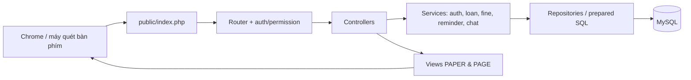
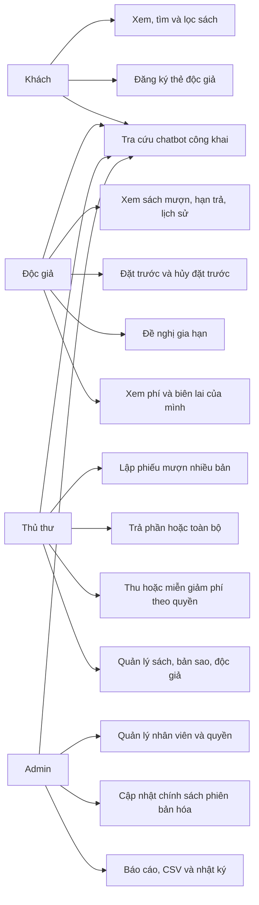

# Kiến trúc hệ thống

Ứng dụng dùng PHP server-rendered theo lớp: `public/index.php` → `Router` → Controller → Service nghiệp vụ → Repository/PDO → MySQL. View/partial escape đầu ra; JavaScript chỉ hỗ trợ tương tác, không làm database nghiệp vụ.



Transaction nằm ở service cho checkout nhiều bản, trả, gia hạn, thu/miễn phí và cập nhật policy. Lock hàng và unique/check/FK bảo vệ khi có cạnh tranh. Các request ghi dùng CSRF, validation và mutation key khi phù hợp. Router kiểm tra role và quyền trước controller; repository tiếp tục giới hạn owner ở dữ liệu cá nhân/biên lai.

Ảnh upload nằm ngoài public raw path, được `CoverController` phục vụ theo tên ngẫu nhiên, MIME cố định và chống sniff. Bìa catalog dùng partial chung, xác minh nguồn và fallback tên/tác giả. PDF/CSV được tạo từ dữ liệu backend với kiểm tra quyền.

Chatbot là module hybrid: rule/intent → service/repository → MySQL; LLM chỉ là adapter tùy chọn để phân loại tìm kiếm công khai. Không có API key vẫn hoạt động. Không chạy SQL do người dùng/LLM sinh và không dùng chat để cấp quyền.

Tác vụ `database/maintenance.php` xử lý hết hạn reservation và nhắc hạn; `database/backup.php` tạo consistent SQL snapshot riêng tư. Các tác vụ này chạy bằng PHP CLI/Task Scheduler, không phụ thuộc lượt truy cập web.

## Use Case theo vai trò



Các đường use case chỉ mô tả khả năng sau khi backend xác thực role/quyền. Độc giả không được truyền `reader_id` để xem hồ sơ người khác; Admin/Thủ thư dùng cùng vùng quản trị nhưng menu và route phụ thuộc permission thực tế.

## Sequence nghiệp vụ mượn và trả

```mermaid
sequenceDiagram
  actor Staff as Thủ thư
  participant UI as Form mượn/trả
  participant Router as Router + CSRF + quyền
  participant Loan as LoanService
  participant DB as MySQL/InnoDB
  Staff->>UI: Chọn độc giả và nhiều mã bản sao
  UI->>Router: POST /admin/loans + mutation key
  Router->>Loan: checkout(reader, copies, actor)
  Loan->>DB: BEGIN + khóa reader/copies/policy
  DB-->>Loan: Trạng thái và policy hiện hành
  Loan->>DB: Tạo loan/items, snapshot phí, cập nhật copies
  Loan->>DB: COMMIT
  Loan-->>UI: Mã phiếu và kết quả thật
  Staff->>UI: Chọn một bản hoặc trả toàn bộ
  UI->>Router: POST return + CSRF + mutation key
  Router->>Loan: returnBook/returnAll
  Loan->>DB: BEGIN + khóa loan/items/copies
  Loan->>DB: Ghi tình trạng trả, phí, tồn kho, notification
  Loan->>DB: COMMIT
  Loan-->>UI: Phiếu trả/biên lai; lần gửi trùng bị từ chối hoặc replay an toàn
```

Nếu bất kỳ bước SQL nào thất bại, transaction rollback toàn bộ header, items, ledger và trạng thái bản sao. Các test fault-injection đã đối chiếu 11 bảng trước/sau rollback.
