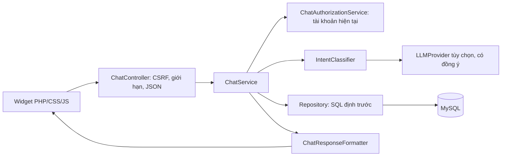

# Trợ lý Thư viện — kiến trúc

Triển khai ngày 12/10/2026 trên source QLTV_MaNguonMo-github-stage. Đây là trợ lý dựa trên quy tắc và dữ liệu MySQL; bộ chuyển đổi LLM là tùy chọn. Không tạo bảng, migration hoặc dependency mới.

## API

- GET `/chat/state`: lời chào, gợi ý, CSRF, phạm vi phiên và khả năng sử dụng AI; không trả API key.
- POST `/chat/message`: JSON `{"message":"Tìm sách tâm lý","_csrf":"token","use_ai":false}`.
- POST `/chat/reset`: JSON chứa `_csrf`, xóa ngữ cảnh.
- Kết quả JSON gồm thông điệp, sách, liên kết, gợi ý và phạm vi phiên. Mã lỗi: 400 JSON sai; 413 body quá lớn; 419 CSRF; 422 thông điệp sai; 429 quá giới hạn; 503 lỗi dịch vụ. Không trả stack trace.

## Nghiệp vụ

Tìm theo tên/tác giả/ISBN/chủ đề, gợi ý theo nội dung, hỏi tình trạng bản sao, xem chi tiết cuốn thứ hai, chính sách hiện tại, hướng dẫn đăng ký/đặt trước/gia hạn. Tên, tác giả, bìa và tồn kho lấy từ repository hiện hữu; không dựng sách bằng JavaScript hoặc LLM. Sách không có trong MySQL trả kết quả rỗng trung thực. Bìa dùng helper chung và fallback hiện hữu; chatbot không khắc phục ba bìa thư mục còn thiếu.

Độc giả chỉ xem phiếu, hạn trả, lịch sử và tiền phạt của tài khoản được liên kết trong database. Không tin `reader_id` hoặc role gửi từ client. Thủ thư cần `loans.view` và `reports.view` để xem báo cáo quá hạn; thông tin tồn kho cần `books.view`. Báo cáo tổng hợp Admin cần role Admin và quyền báo cáo. Kiểm tra lại trạng thái tài khoản, phiên bản mật khẩu và quyền ở mỗi yêu cầu.

Gia hạn/đặt trước/thanh toán chỉ hướng dẫn và dẫn tới trang nghiệp vụ đã có; chatbot không tự thay đổi phiếu hay thu tiền. `FineService::previewBalance` và `previewTotalBalance` tính theo snapshot phí, khoản đã thu/miễn; không đồng bộ ghi ledger khi chỉ hỏi. Truy vấn cá nhân giới hạn 20 dòng; tìm sách tối đa 10; báo cáo truy vấn theo tập hợp, không truy vấn từng thẻ sách. Tìm không dấu dùng collation MySQL 8 `utf8mb4_0900_ai_ci`, được kiểm tra trên MySQL 8.4 hiện tại.

## Phiên và bảo mật

Session chỉ lưu ID sách đã tìm, sách đang chọn và dấu nhận dạng tài khoản; hết hạn sau 20 phút. Không lưu lịch sử câu hỏi ở MySQL hoặc localStorage. Tin nhắn chỉ nằm trong DOM hiện tại, tối đa 40 mục. Reset, đổi tài khoản và mất hiệu lực tài khoản làm mất ngữ cảnh. Widget nhận phạm vi phiên mới để xóa nội dung cũ khi cập nhật trạng thái.

POST tối đa 6.000 byte; thông điệp UTF-8 tối đa 1.000 ký tự. Giới hạn theo IP và namespace database: 30 POST/phút, 60 GET trạng thái/phút, lưu bộ đếm băm dưới `storage/cache/chat_limits`, khóa file để tránh tranh chấp. Bộ đếm không chứa câu hỏi, IP thô hoặc khóa. Có thể dọn file bộ đếm hết hạn trong bảo trì; chưa có tác vụ tự dọn. SQL prepared/định trước, không thực thi SQL từ câu hỏi hoặc LLM. DOM dùng textContent, liên kết cùng origin, ảnh theo nguồn đã chấp thuận. Không ghi câu hỏi hoặc bí mật vào log lỗi.

## File chính

`app/Controllers/ChatController.php`, `app/Services/ChatService.php`, `IntentClassifier.php`, `ChatAuthorizationService.php`, `LibrarySearchService.php`, `ChatResponseFormatter.php`, `ChatRateLimiter.php`, `LLMProvider.php`; `app/Repositories/ChatRepository.php`; `app/Views/partials/chat_widget.php`; `public/assets/js/chat.js`; `public/assets/css/chat.css`.

Widget có mặt trong layout công khai và layout tài khoản, giữ nguyên token màu/font PAPER & PAGE. Không thay CSS nền hoặc dependency.
