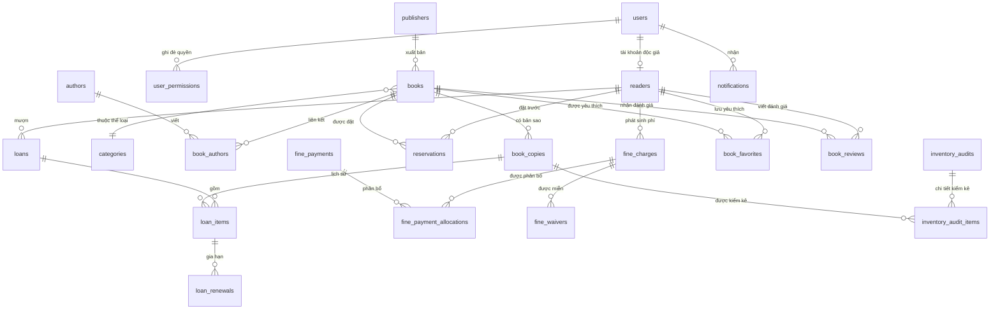

# Thiết kế cơ sở dữ liệu

Schema thực tế gồm 29 bảng, 44 khóa ngoại và migration `001`–`012` trên MySQL 8.4.3.

`book_copies.copy_code` và barcode khác NULL là duy nhất. Generated active-copy constraint ngăn một bản sao xuất hiện trong hai `loan_items` chưa trả. Trạng thái bản sao gồm available/on_loan/reserved/damaged/lost/retired; service đồng bộ với loan/reservation và điều kiện vật lý. `books.total_copies` là cache số bản vận hành, được đối chiếu với bản sao; tồn khả dụng tính từ `book_copies` và reservation ready.

Phiếu lưu snapshot hạn trả, mức phí và policy version để thay đổi chính sách không viết lại lịch sử. Ledger phí tách charge/payment/allocation/waiver, có constraint chống số âm, over-allocation và deduplication. `mutation_requests` giữ khóa idempotency cho thao tác ghi quan trọng.

Quyền gồm quyền theo role và ghi đè theo user. Dữ liệu cá nhân được lấy từ user/session đã xác thực; backend không tin reader ID do client tự gửi. Chatbot không thêm bảng hội thoại và chỉ giữ context giới hạn trong PHP session.

Migration chỉ nâng cấp schema hiện hữu và ghi registry; không seed/reset. Trước migration phải chạy backup. Chi tiết từng cột xem `DATA_DICTIONARY.md`, luồng nâng cấp xem `MIGRATION_GUIDE.md`.
