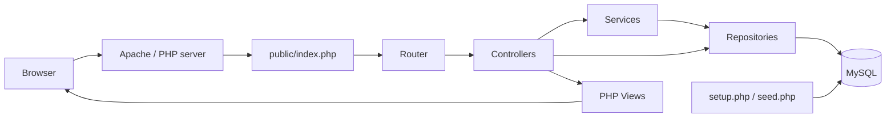
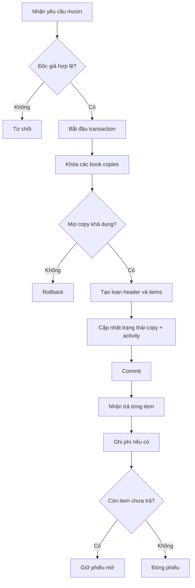
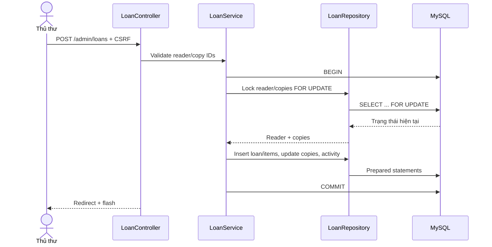
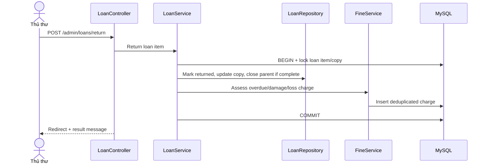
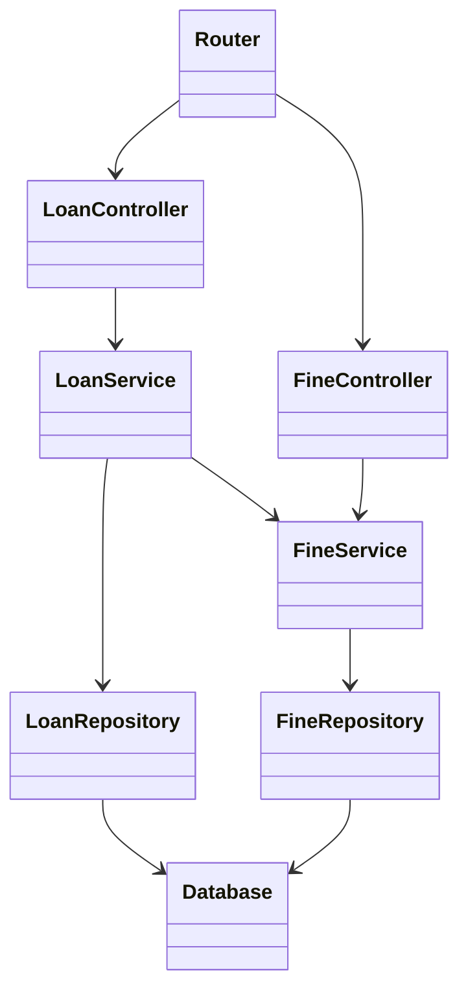
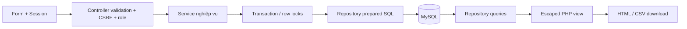

# Sơ đồ hệ thống

Các sơ đồ Mermaid dưới đây mô tả source hiện tại; có thể chỉnh sửa trực tiếp.

## Kiến trúc

## Hoạt động mượn và trả

## Sequence lập phiếu

## Sequence nhận trả

## Class/module view

## Dòng dữ liệu mức tổng quan

