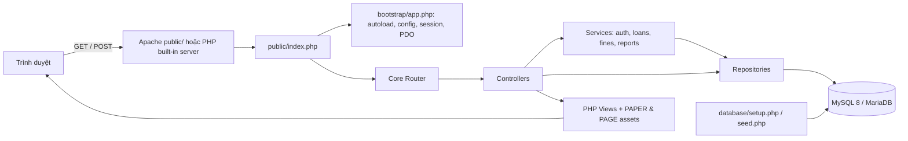

# Kiến trúc hệ thống

## Tổng quan

Ứng dụng là PHP server-rendered, dùng MySQL qua PDO. `public/index.php` là entry point; route dispatch điều phối đến controller. Controller xác thực input/quyền, service áp dụng nghiệp vụ, repository thực hiện SQL. View chỉ render dữ liệu đã chuẩn bị; các thao tác thay đổi dùng POST, CSRF token và redirect/flash.

## Các lớp và ranh giới

- **Presentation:** `app/Views`, `public/assets`, form HTML; không query database trực tiếp.
- **Routing/controller:** `app/Core/Router.php`, `app/Controllers`; ánh xạ method/path, role guard, validation request và render/redirect.
- **Business logic:** `app/Services`; điều kiện mượn/trả, gia hạn, FIFO reservation, ledger và thanh toán.
- **Data access:** `app/Repositories`; prepared statements, joins, khóa hàng và persistence.
- **Platform:** `app/Core/Database.php`, `Session.php`, `Csrf.php`, `Config.php`; PDO, session, CSRF và cấu hình.
- **Persistence:** schema và migration `database/`; InnoDB, foreign keys, indexes, transactions.

## Luồng request

1. Web server chỉ phục vụ document root `public/`; front controller khởi tạo bootstrap.
2. Router chuẩn hóa path và chọn controller.
3. Middleware/helpers yêu cầu đăng nhập, role phù hợp và CSRF cho POST.
4. Controller chuẩn hóa input và gọi service/repository.
5. Nghiệp vụ nhiều bước dùng transaction; thao tác tồn kho khóa bản sao liên quan.
6. View escape dữ liệu khi render; kết quả thao tác chuyển hướng kèm thông báo.

## Cấu hình và vận hành

`.env` nằm ở project root, không thuộc `public/` và bị loại khỏi Git. `database/setup.php` tạo database nếu chưa tồn tại, ghi `schema_migrations` và áp dụng migration chưa chạy. Setup/seed không phải API HTTP. Hướng dẫn cấu hình chi tiết: [INSTALLATION_GUIDE.md](./INSTALLATION_GUIDE.md).

## Giới hạn kiến trúc hiện tại

- Router MVC tối giản, không phải framework và chưa có REST/JSON API.
- Vai trò lưu dạng enum; chưa có role/permission tables.
- Không có queue worker/cron; một số sự kiện thông báo được tạo đồng bộ cùng nghiệp vụ.
- Không có upload, PDF generation hoặc frontend build pipeline.

## Hoàn thiện 08/10/2026

InventoryController → CopyRepository/MetadataRepository; ProfileController cho staff; Pagination điều phối LIMIT/OFFSET; ReportRepository cho kho/phí; ReminderService và maintenance CLI. LoginThrottle dùng file hash email/IP với flock ngoài public/, không lưu credential. Session strict/timeout; require_auth xác minh tài khoản/role hiện hành từ DB. Không tạo ARCHITECTURE.md trùng; tài liệu kiến trúc chính là tệp này.
