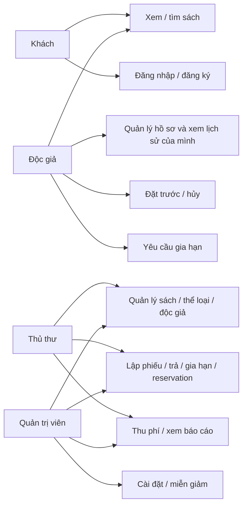
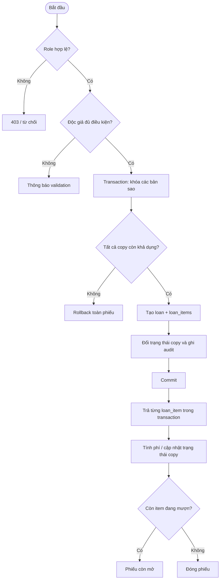

# Ca sử dụng

## Tác nhân và khả năng

| Tác nhân | Ca sử dụng đang hỗ trợ |
|---|---|
| Khách | Xem trang chủ, tìm/lọc danh mục, xem chi tiết/thể loại, đăng nhập; đăng ký nếu cấu hình bật. |
| Độc giả | Xem tài khoản, lịch sử/phiếu, hạn trả, thông báo và phí; cập nhật hồ sơ/đổi mật khẩu; đặt trước, hủy đặt trước và yêu cầu gia hạn theo chính sách. |
| Thủ thư | Quản lý sách/thể loại/độc giả; lập phiếu nhiều bản, nhận trả từng bản, gia hạn, quản lý reservation, thu phí, xem dashboard/báo cáo. |
| Quản trị viên | Các chức năng vận hành của thủ thư; sửa cài đặt thư viện và miễn/giảm phí. |

Quản lý tài khoản/thủ thư và phân quyền theo permission riêng chưa có giao diện triển khai. Xem [REQUIREMENTS.md](./REQUIREMENTS.md).

## Use-case overview

## Ca sử dụng tiêu biểu

### UC-01 — Lập phiếu mượn

- **Tác nhân:** thủ thư hoặc quản trị viên.
- **Điều kiện:** tài khoản có role cho phép, độc giả hoạt động và đủ điều kiện, bản sao khả dụng.
- **Kết quả:** một phiếu và các mục mượn được ghi transaction; copy đổi trạng thái, activity/notification được ghi theo luồng.
- **Lỗi:** thiếu input, độc giả không đủ điều kiện, copy không khả dụng hoặc lỗi persistence thì thao tác bị từ chối/rollback.

### UC-02 — Trả một bản sao

- **Tác nhân:** thủ thư hoặc quản trị viên.
- **Kết quả:** ghi ngày trả và tình trạng; copy được giải phóng, phí thích hợp được ledger ghi nhận, phiếu chỉ đóng khi không còn mục đang mượn.
- **Chống lặp:** mục đã trả không thể trả lần nữa.

### UC-03 — Thanh toán phí

- **Tác nhân:** thủ thư hoặc quản trị viên; quản trị viên có thêm quyền miễn/giảm.
- **Kết quả:** payment và allocation được ghi trong transaction, theo khoản phí cũ trước; không nhận số tiền vượt dư nợ.

## Sơ đồ hoạt động mượn/trả

## Ca sử dụng bổ sung đã nghiệm thu

Staff quản lý bản sao/kệ/tình trạng và metadata tác giả/NXB; xem lịch sử độc giả, khôi phục thẻ, sửa hồ sơ/mật khẩu; xuất CSV kho/phí. Reminder sắp/quá hạn chống trùng khi reader mở tài khoản hoặc CLI maintenance chạy. Chi tiết PASS trong TEST_REPORT.md.
