# ĐỒ ÁN MÔN HỌC: LẬP TRÌNH MÃ NGUỒN MỞ
## BÁO CÁO TỔNG KẾT DỰ ÁN
# PAPER HAVEN — HỆ THỐNG QUẢN LÝ THƯ VIỆN TRỰC TUYẾN
### (Online Library Management System)

---

## 1. THÔNG TIN CHUNG VỀ ĐỀ TÀI

* **Tên đề tài:** Paper Haven – Hệ thống Quản lý Thư viện Trực tuyến
* **Tên tiếng Anh:** Paper Haven Online Library Management System
* **Môn học:** Lập trình Mã nguồn mở (Open Source Programming)
* **Ngôn ngữ & Nền tảng:** PHP 8.3 (Native MVC OOP), MySQL 8.4, HTML5/CSS3/JavaScript ES6+, Laragon WAMP Environment
* **Mục tiêu học phần:** Ứng dụng các công nghệ, quy chuẩn và thư viện mã nguồn mở tiêu chuẩn vào việc xây dựng một hệ thống thông tin hoàn chỉnh, có kiến trúc phân tầng rõ ràng, bảo mật cao và vận hành ổn định trong môi trường thực tế.

---

## 2. BỐI CẢNH VÀ TÍNH CẤP THIẾT CỦA ĐỀ TÀI

Trong kỷ nguyên số hóa giáo dục và nghiên cứu, quản lý thư viện truyền thống bằng sổ sách hoặc bảng tính Excel thủ công bộc lộ nhiều điểm yếu nghiêm trọng:
1. **Thất thoát sách và sai lệch tồn kho:** Không quản lý được chi tiết theo từng cuốn sách vật lý (bản sao - copy-level inventory), dẫn đến tình trạng sách mất nhưng trên hệ thống vẫn ghi còn.
2. **Quy trình mượn - trả chậm chạp:** Thủ thư mất thời gian tra cứu thủ công, không kiểm soát được hạn mượn và tính phí phạt trễ hạn chính xác.
3. **Độc giả thiếu kênh tương tác:** Độc giả không thể tra cứu mục lục trực tuyến (OPAC), không thể giữ chỗ trước (reservation) khi sách đang được mượn, và không nhận được thông báo kịp thời.
4. **Vấn đề toàn vẹn dữ liệu thư mục:** Rất nhiều phần mềm mô phỏng tạo ra sách giả, ISBN ảo, bìa sách tự sinh bằng AI không phản ánh đúng ấn bản thật, vi phạm nghiêm trọng tính chuẩn tắc của thư viện học.

**Paper Haven** ra đời nhằm giải quyết triệt để những bất cập trên bằng cách cung cấp một giải pháp quản lý thư viện mã nguồn mở chuyên nghiệp, minh bạch, tuân thủ nghiêm ngặt chuẩn quản lý thư viện quốc tế và đạo đức dữ liệu khoa học.

---

## 3. MỤC TIÊU VÀ PHẠM VI DỰ ÁN

### 3.1. Mục tiêu tổng quát
Xây dựng một giải pháp Web Application hoàn chỉnh phục vụ đầy đủ 3 nhóm đối tượng: Quản trị viên (Admin), Thủ thư (Librarian) và Độc giả (Reader), đáp ứng toàn diện các tiêu chí đánh giá xuất sắc của đồ án Lập trình Mã nguồn mở.

### 3.2. Mục tiêu cụ thể
* **Về mặt nghiệp vụ thư viện:**
  - Quản lý mục lục sách chuẩn hóa theo mô hình phân tầng: Đầu sách (*Title/Work*) tách biệt với Bản sao vật lý (*Physical Copy*).
  - Quản lý lưu thông (Circulation) với đầy đủ quy trình: Mượn sách, Gia hạn (Renewal), Trả sách (Return) kèm biên nhận điện tử (E-Receipt PDF/HTML).
  - Hệ thống tính phí phạt tự động (Fine Engine) theo công thức lũy tiến hàng ngày, hỗ trợ thanh toán một phần (partial allocation) và miễn giảm (waiver) có kiểm toán.
  - Quản lý giữ chỗ sách (Reservation) theo hàng đợi FIFO (First-In, First-Out) tự động kích hoạt khi có bản sao sẵn sàng.
  - Kiểm kê tồn kho chuyên sâu (Inventory Audit) hỗ trợ quét mã vạch Barcode (Code 128) và mã phản hồi nhanh QR Code.
  - Nhập dữ liệu an toàn hàng loạt (Safe CSV Import) với cơ chế preview, validate và transaction nguyên tử.
* **Về mặt kỹ thuật mã nguồn mở:**
  - Áp dụng kiến trúc Model-View-Controller (MVC) chuẩn mực, hướng đối tượng (OOP Strict Types).
  - Sử dụng 100% thành phần mã nguồn mở FOSS (Free and Open-Source Software) có giấy phép rõ ràng (MIT, Apache 2.0, LGPL).
  - Tối ưu hóa hiệu năng, bảo mật chống SQL Injection, XSS, CSRF, Session Hijacking và Race Conditions.
  - Cam kết 100% dữ liệu sách thực (Real Books), không bịa đặt ISBN, không sử dụng ảnh bìa do AI tạo ra.

---

## 4. CÁC TÍNH NĂNG NỔI BẬT CỦA PAPER HAVEN

```mermaid
graph TD
    A[Paper Haven System] --> B[Tra cứu & Khám phá Sách]
    A --> C[Quản lý Lưu thông & Phí phạt]
    A --> D[Kiểm kê & Quản lý Kho vật lý]
    A --> E[Tương tác Độc giả & Trợ lý ảo]
    A --> F[Quản trị & Báo cáo Kiểm toán]

    B --> B1[Tìm kiếm Full-text, Lọc đa chiều]
    B --> B2[Trang chi tiết sách chuẩn thư mục]
    B --> B3[Gợi ý sách tương tự / Cùng thể loại]

    C --> C1[Mượn / Trả / Gia hạn sách]
    C --> C2[Biên nhận điện tử có mã vạch / QR]
    C --> C3[Tính phạt lũy tiến & Quyết toán]

    D --> D1[Mã vạch Code 128 & QR Code SVG]
    D --> D2[Đợt kiểm kê & Đối soát sai lệch]
    D --> D3[Khu vực cách ly sách chờ xử lý]

    E --> E1[Đánh giá, bình luận & Yêu thích]
    E --> E2[Hàng đợi giữ chỗ tự động FIFO]
    E --> E3[Chatbot quy tắc nội bộ & Hỗ trợ AI]

    F --> F1[Phân quyền động RBAC + Action Matrix]
    F --> F2[Nhật ký hoạt động kiểm toán Activity Log]
    F --> F3[Báo cáo Dashboard trực quan KPI]
```

1. **Hệ thống Quản lý Bản sao Vật lý (Copy-level Tracking):** Mỗi cuốn sách có mã định danh bản sao duy nhất (`copy_code`), vị trí kệ cụ thể (`shelf_location`), tình trạng vật lý (`condition_note`) và trạng thái vòng đời (`available`, `on_loan`, `damaged`, `lost`, `pending_audit`).
2. **Biên nhận điện tử (E-Receipts):** Tạo biên nhận mượn, trả và thanh toán phí phạt với định dạng in nhiệt chuyên nghiệp, mã vạch tra cứu tức thì.
3. **Trợ lý thư viện thông minh (Chatbot):** Cơ chế lai (Hybrid) gồm bộ máy khớp mẫu quy tắc nội bộ độc lập (Rule-based Regex matcher) với thời gian phản hồi dưới 2ms, kết hợp tùy chọn API Google Gemini khi có cấu hình key.
4. **Hàng rào kiểm soát chất lượng dữ liệu (Provenance & Quality Gate):** Bộ công cụ Dashboard kiểm tra độ bao phủ ISBN, kiểm tra metadata rỗng, cô lập các bản sao chưa thẩm định vào "Kho tiếp nhận — Chờ kiểm kê" để ngăn ngừa lưu thông sai lệch.
5. **Thiết kế giao diện thích ứng (Responsive Modern UI):** Giao diện thiết kế theo phong cách thư viện hiện đại, phối màu ấm áp (Warm Amber/Paper Palette), tối ưu hóa trải nghiệm trên Desktop, Tablet và Mobile.
