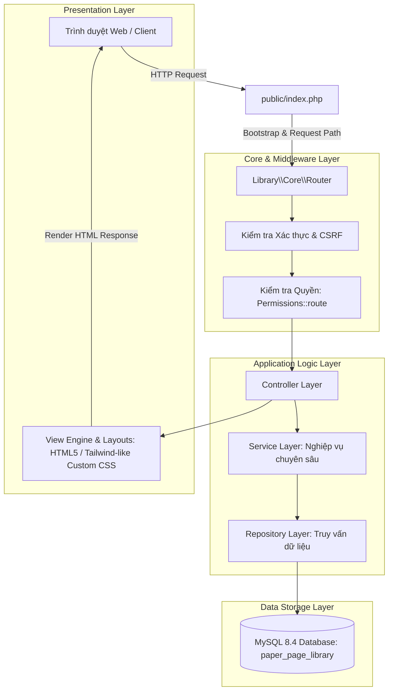

# ĐỒ ÁN MÔN HỌC: LẬP TRÌNH MÃ NGUỒN MỞ
## PHẦN 3: KIẾN TRÚC PHẦN MỀM MVC OOP & TỔ CHỨC MÃ NGUỒN

---

## 1. MÔ HÌNH KIẾN TRÚC TỔNG THỂ (LAYERED MVC ARCHITECTURE)

Paper Haven được thiết kế theo mô hình **Phân tầng (Layered Architecture)** kết hợp với mẫu kiến trúc **Model-View-Controller (MVC)** chuẩn hướng đối tượng trong PHP 8.3:



### Nguyên tắc phân tách trách nhiệm (Separation of Concerns):
1. **Controller Layer (`app/Controllers/`):** Chỉ tiếp nhận HTTP Request, giải mã tham số, gọi Service xử lý và điều phối dữ liệu sang View hoặc trả về JSON API. Không chứa câu lệnh SQL trực tiếp.
2. **Service Layer (`app/Services/`):** Chứa toàn bộ nghiệp vụ nghiệp vụ thư viện (Business Logic): quy tắc mượn/trả, gia hạn, tính phí phạt lũy tiến, phân bổ thanh toán, đối soát kiểm kê, thuật toán gợi ý sách, xử lý hội thoại chatbot.
3. **Repository Layer (`app/Repositories/`):** Đóng gói toàn bộ thao tác với cơ sở dữ liệu MySQL bằng PDO Prepared Statements. Đảm bảo dữ liệu truy xuất ra được đóng gói chuẩn mực.
4. **Core Layer (`app/Core/`):** Cung cấp các nền tảng hạ tầng của framework tự xây dựng: Router, Database, View Engine, Config, Session, Permissions.

---

## 2. SƠ ĐỒ CẤU TRÚC THƯ MỤC DỰ ÁN

```text
QLTV_MaNguonMo-github-stage/
│
├── app/                                # Mã nguồn chính của ứng dụng (Namespace: Library\)
│   ├── Controllers/                    # Bộ điều khiển (12 controllers)
│   │   ├── AuthController.php          # Đăng nhập, đăng ký, đăng xuất, quên mật khẩu
│   │   ├── CatalogController.php       # Tra cứu mục lục, chi tiết sách, lọc danh mục
│   │   ├── ChatController.php          # API giao tiếp trợ lý ảo Chatbot
│   │   ├── CoverController.php         # Phục vụ ảnh bìa sách tối ưu hóa
│   │   ├── DashboardController.php     # Bảng điều khiển tổng hợp cho Admin & Thủ thư
│   │   ├── FineController.php          # Quản lý phí phạt, thu tiền, miễn giảm phạt
│   │   ├── InventoryAuditController.php# Đợt kiểm kê, quét mã vạch, xử lý thất thoát
│   │   ├── LoanController.php          # Lưu thông: mượn sách, trả sách, gia hạn
│   │   ├── ManagementController.php    # Quản lý danh mục sách, bản sao, tác giả, NXB
│   │   ├── NotificationController.php  # Thông báo hệ thống cho độc giả & thủ thư
│   │   ├── ReaderController.php        # Quản lý hồ sơ độc giả, cấp thẻ thư viện
│   │   ├── ReceiptController.php       # Xuất biên nhận mượn/trả/thu tiền dạng in nhiệt
│   │   ├── ReviewController.php         # Đánh giá sách, bình luận, quản lý yêu thích
│   │   └── StaffController.php          # Quản trị nhân viên, phân quyền RBAC, nhật ký
│   │
│   ├── Core/                           # Các lớp cốt lõi của hệ thống
│   │   ├── Config.php                  # Đọc và ép kiểu an toàn từ file môi trường .env
│   │   ├── Database.php                # Kết nối PDO Singleton (UTF-8mb4, Prepared Statements)
│   │   ├── Permissions.php             # Bộ định tuyến quyền hạn theo đường dẫn (Action Matrix)
│   │   ├── Router.php                  # Bộ điều phối tuyến đường HTTP (Fast Regex Routing)
│   │   └── View.php                    # Trình kết xuất giao diện và bố cục (Layout Engine)
│   │
│   ├── Repositories/                   # Lớp thao tác dữ liệu MySQL
│   │   ├── ActivityLogRepository.php   # Ghi nhật ký kiểm toán hoạt động
│   │   ├── BookRepository.php          # Tìm kiếm sách, metadata, thể loại, tác giả
│   │   ├── CopyRepository.php          # Quản lý bản sao, trạng thái, vị trí kệ
│   │   ├── FineRepository.php          # Xử lý phí phạt, phiếu thu, phân bổ, miễn giảm
│   │   ├── InventoryAuditRepository.php# Phiếu kiểm kê, chi tiết quét, đối soát sai lệch
│   │   ├── LoanRepository.php          # Phiếu mượn, dòng mượn, gia hạn, trả sách
│   │   ├── ReaderRepository.php        # Tài khoản độc giả, hạn thẻ, khóa thẻ
│   │   ├── ReservationRepository.php   # Hàng đợi giữ chỗ FIFO, thông báo sẵn sàng
│   │   ├── ReviewRepository.php        # Đánh giá sao, nhận xét độc giả
│   │   └── SystemSettingRepository.php # Cấu hình chính sách thư viện, phí phạt ngày
│   │
│   ├── Services/                       # Lớp nghiệp vụ chuyên sâu
│   │   ├── BarcodeService.php          # Sinh mã vạch Code 128 dạng SVG thuần
│   │   ├── ChatService.php             # Xử lý hội thoại độc giả (Rule-based & AI Fallback)
│   │   ├── FineService.php             # Tính phí phạt trễ hạn, thu tiền, kiểm toán
│   │   ├── InventoryAuditService.php   # Nghiệp vụ kiểm kê, xử lý sách mất/hỏng
│   │   ├── LoanService.php             # Nghiệp vụ mượn trả, kiểm tra giới hạn độc giả
│   │   ├── QrCodeService.php           # Sinh mã phản hồi nhanh QR Code dạng SVG
│   │   ├── ReceiptService.php          # Định dạng dữ liệu biên nhận điện tử
│   │   └── RecommendationService.php   # Thuật toán gợi ý sách tương đồng
│   │
│   ├── Views/                          # Tầng giao diện người dùng
│   │   ├── layouts/                    # Bố cục chung (public.php, staff.php)
│   │   ├── admin/                      # Giao diện quản trị, thủ thư, kiểm kê, báo cáo
│   │   ├── public/                     # Giao diện tra cứu mục lục và chi tiết sách
│   │   ├── reader/                     # Giao diện cổng thông tin bạn đọc & tủ sách
│   │   └── receipts/                   # Mẫu in biên nhận mượn, trả, thu tiền
│   │
│   └── Support/
│       └── helpers.php                 # Các hàm tiện ích toàn cục (escape, csrf, auth,...)
│
├── bootstrap/                          # Khởi tạo ứng dụng
│   └── app.php                         # Nạp autoloader, cấu hình múi giờ, session
│
├── database/                           # Quản lý cấu trúc dữ liệu
│   ├── migrate.php                     # Trình thực thi migration tự động
│   ├── schema.sql                      # Bản thiết kế lược đồ CSDL ban đầu
│   └── migrations/                     # 16 tệp Migration phiên bản hóa
│
├── docs/                               # Toàn bộ tài liệu kỹ thuật, audit và hồ sơ nộp môn
│   ├── submission/                     # 10 tệp tài liệu chính thức nộp môn
│   ├── BOOK_COVER_MATCH_REPORT.md      # Báo cáo đối soát 56 ảnh bìa
│   ├── FINAL_FEATURE_AUDIT.md          # Báo cáo kiểm định 15 module chức năng
│   └── FINAL_HANDOVER.md               # Hồ sơ bàn giao dự án
│
├── public/                             # Thư mục gốc web công khai (Document Root)
│   ├── index.php                       # Điểm vào duy nhất (Single Entry Point)
│   ├── assets/                         # Tài nguyên tĩnh (CSS, JS, Fonts, Icons)
│   └── uploads/                        # Thư mục lưu trữ tệp người dùng tải lên
│
├── storage/                            # Thư mục lưu trữ tạm thời, log, cache
│   ├── doi_soat/                       # Ảnh sách đối soát từ kho đề cương
│   └── logs/                           # Nhật ký lỗi ứng dụng (app.log)
│
├── tests/                              # Bộ kiểm thử tự động toàn diện
│   ├── lint.php                        # Kiểm tra cú pháp PHP toàn bộ dự án
│   ├── run.php                         # Kiểm thử smoke test các chức năng cốt lõi
│   ├── test_v8_features.php            # Kiểm thử tính năng nghiệp vụ sâu
│   ├── test_v8_inventory_audit_deep.php# Kiểm thử kiểm kê tồn kho và quét mã
│   ├── test_v8_chatbot_hardening.php   # Kiểm thử bảo mật và phản hồi Chatbot
│   ├── postflight_check.php            # Kiểm thử toàn vẹn CSDL sau migration
│   └── test_v12_2_postflight_business.php # Kiểm thử tích hợp nghiệp vụ 3 vai trò
├── composer.json                       # Định nghĩa phụ thuộc và PSR-4 Autoload
└── .env.example                        # Mẫu cấu hình môi trường chuẩn
```

---

## 3. CÁC CƠ CHẾ AN TOÀN VÀ BẢO MẬT ĐƯỢC TÍCH HỢP

1. **Phòng chống SQL Injection (100% Parameterized Queries):**
   - Không sử dụng phép ghép chuỗi thô để xây dựng câu lệnh SQL.
   - Toàn bộ tham số đầu vào được bind qua PDO Prepared Statements với kiểu dữ liệu tường minh (`PDO::PARAM_INT`, `PDO::PARAM_STR`).

2. **Phòng chống Cross-Site Scripting (XSS):**
   - Mọi dữ liệu xuất ra màn hình trong các file View bắt buộc phải đi qua hàm trợ giúp `e()` hoặc `htmlspecialchars($value, ENT_QUOTES, 'UTF-8')`.

3. **Bảo vệ chống Cross-Site Request Forgery (CSRF):**
   - Tất cả các biểu mẫu `POST`, `PUT`, `DELETE` đều chứa trường ẩn `csrf_token()`.
   - Cơ chế middleware tự động kiểm tra token khớp với session người dùng trước khi chuyển tiếp yêu cầu đến Controller.

4. **Bảo mật phiên đăng nhập và Mật khẩu:**
   - Mật khẩu được băm một chiều bằng thuật toán `bcrypt` chuẩn thông qua hàm `password_hash()` với độ phức tạp cao (`PASSWORD_DEFAULT`).
   - Sau khi đăng nhập thành công, hệ thống tự động tái tạo ID phiên làm việc (`session_regenerate_id(true)`) để ngăn chặn tấn công chiếm quyền phiên (Session Fixation).
   - Cookie phiên được gắn cờ `HttpOnly`, `SameSite=Lax`.

5. **Phân quyền đa tầng (Defense in Depth):**
   - Tầng 1: Kiểm tra vai trò tài khoản (`admin`, `librarian`, `reader`).
   - Tầng 2: Kiểm tra ma trận quyền hành động cụ thể (`Permissions::route()`) gắn với cơ sở dữ liệu bảng `permissions`, `role_permissions` và `user_permissions`.
