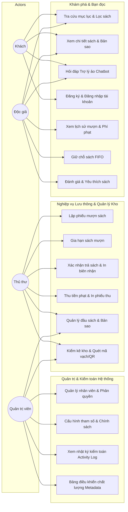

# ĐỒ ÁN MÔN HỌC: LẬP TRÌNH MÃ NGUỒN MỞ
## PHẦN 4: SƠ ĐỒ USE CASE & MA TRẬN PHÂN QUYỀN (RBAC & ACTION PERMISSIONS)

---

## 1. CÁC TÁC NHÂN TRONG HỆ THỐNG (ACTORS)

Hệ thống **Paper Haven** định nghĩa 4 nhóm tác nhân chính:

1. **Khách vãng lai (Guest / Anonymous User):**
   - Người dùng chưa đăng nhập vào hệ thống. Có thể tra cứu mục lục sách, xem thông tin chi tiết các đầu sách, kiểm tra số lượng bản sao còn trên giá, trò chuyện với trợ lý ảo Chatbot để hỏi thông tin thư viện, và đăng ký tài khoản bạn đọc mới.
2. **Độc giả (Reader / Patron):**
   - Bạn đọc chính thức của thư viện có tài khoản và mã thẻ thư viện (`card_number`). Có thể xem lịch sử mượn trả, kiểm tra các khoản phí phạt của mình, đặt trước sách (giữ chỗ) khi sách hết bản sao sẵn sàng, gửi đánh giá (review), bình luận, thêm sách vào danh sách yêu thích cá nhân, nhận thông báo hệ thống và in thẻ thư viện.
3. **Thủ thư (Librarian):**
   - Cán bộ nghiệp vụ chịu trách nhiệm vận hành thư viện hàng ngày. Thực hiện lập phiếu mượn sách, gia hạn mượn, nhận trả sách, in biên nhận điện tử, thu tiền phạt và xử lý miễn giảm theo quy định, quản lý danh mục sách và bản sao vật lý, tạo đợt kiểm kê và quét mã vạch đối soát kho sách.
4. **Quản trị viên hệ thống (Admin):**
   - Nắm toàn quyền quản trị kỹ thuật và chính sách của Paper Haven. Quản lý tài khoản cán bộ và độc giả, cấu hình ma trận phân quyền chi tiết (Permissions Matrix), cấu hình thông số thư viện (phí phạt trễ hạn/ngày, thời hạn mượn tối đa, số lượng sách mượn tối đa), xem nhật ký kiểm toán hoạt động (`activity_logs`), theo dõi bảng điều khiển chất lượng dữ liệu sách (Metadata Quality Dashboard).

---

## 2. SƠ ĐỒ USE CASE TỔNG THỂ

---

## 3. MA TRẬN PHÂN QUYỀN HÀNH ĐỘNG (ACTION PERMISSIONS MATRIX)

Hệ thống kết hợp giữa **Role-Based Access Control (RBAC)** và **Granular Action Permissions** được định nghĩa trong bảng `permissions` và ánh xạ qua lớp `Library\Core\Permissions`:

| Tuyến đường (Route) | Phương thức | Hành động nghiệp vụ | Quyền yêu cầu (Permission Slug) | Reader | Librarian | Admin |
| :--- | :---: | :--- | :--- | :---: | :---: | :---: |
| `/` & `/catalog` | `GET` | Xem danh mục sách công khai | Không yêu cầu | Yes | Yes | Yes |
| `/book/{id}` | `GET` | Xem thông tin chi tiết đầu sách | Không yêu cầu | Yes | Yes | Yes |
| `/chat/message` | `POST` | Tương tác với trợ lý Chatbot | Không yêu cầu | Yes | Yes | Yes |
| `/login` & `/register` | `GET/POST`| Xác thực tài khoản | Không yêu cầu | Yes | Yes | Yes |
| `/book/{id}/favorite` | `POST` | Thêm / Bỏ yêu thích sách | Xác thực Reader | Yes | No | No |
| `/book/{id}/review` | `POST` | Gửi đánh giá sao & nhận xét | Xác thực Reader | Yes | No | No |
| `/reservations` | `POST` | Đặt trước sách (Hàng đợi FIFO)| Xác thực Reader | Yes | No | No |
| `/receipts/{type}/{id}`| `GET` | Xem / In biên nhận điện tử | Xác thực Reader / Staff | Yes | Yes | Yes |
| `/admin` | `GET` | Truy cập bảng điều khiển Dashboard | `dashboard.view` | No | Yes | Yes |
| `/admin/loans` | `GET/POST`| Lập phiếu mượn sách mới | `loans.manage` | No | Yes | Yes |
| `/admin/loans/return` | `POST` | Nhận sách trả & xuất biên nhận | `loans.manage` | No | Yes | Yes |
| `/admin/loans/renew` | `POST` | Gia hạn mượn sách | `loans.manage` | No | Yes | Yes |
| `/admin/fines` | `GET` | Tra cứu danh sách phí phạt trễ hạn| `fines.manage` | No | Yes | Yes |
| `/admin/fines/pay` | `POST` | Thu tiền phạt độc giả | `fines.manage` | No | Yes | Yes |
| `/admin/fines/waive` | `POST` | Miễn giảm khoản phạt có lý do | `fines.waive` | No | No | Yes |
| `/admin/books` | `GET/POST`| Thêm / Sửa / Đổi thông tin sách | `books.manage` | No | Yes | Yes |
| `/admin/books/import`| `POST` | Nhập sách hàng loạt bằng file CSV| `books.import` | No | No | Yes |
| `/admin/inventory-audits`| `GET/POST`| Tạo đợt kiểm kê, quét mã Barcode | `inventory.audit` | No | Yes | Yes |
| `/admin/readers` | `GET/POST`| Quản lý tài khoản độc giả, hạn thẻ | `readers.manage` | No | Yes | Yes |
| `/admin/users` | `GET/POST`| Quản lý tài khoản cán bộ | `users.manage` | No | No | Yes |
| `/admin/permissions` | `GET/POST`| Cấu hình ma trận quyền hạn | `permissions.manage` | No | No | Yes |
| `/admin/settings` | `GET/POST`| Cấu hình tham số thư viện | `settings.manage` | No | No | Yes |
| `/admin/activity` | `GET` | Xem nhật ký kiểm toán hệ thống | `activity.view` | No | No | Yes |

---

## 4. CƠ CHẾ GHI ĐÈ QUYỀN RIÊNG BIỆT (PER-USER OVERRIDE)

Để đáp ứng tính linh hoạt trong phân công công việc của thư viện mà không cần thay đổi vai trò hệ thống:
1. Mỗi người dùng (`users`) được kế thừa toàn bộ quyền từ vai trò của họ (`roles`: `admin` hoặc `librarian`) thông qua bảng `role_permissions`.
2. Hệ thống hỗ trợ bảng `user_permissions` cho phép cấp thêm quyền đặc biệt (`is_granted = 1`) hoặc thu hồi quyền cụ thể (`is_granted = 0`) cho từng cá nhân thủ thư mà không ảnh hưởng đến các thủ thư khác.
3. Khi kiểm tra quyền, phương thức `has_permission($permission)` sẽ ưu tiên kiểm tra bản ghi cá nhân trong `user_permissions` trước, nếu không có mới xét đến quyền theo vai trò trong `role_permissions`.
