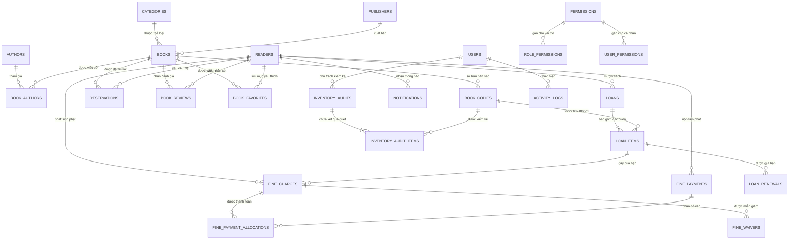

# ĐỒ ÁN MÔN HỌC: LẬP TRÌNH MÃ NGUỒN MỞ
## PHẦN 5: THIẾT KẾ CƠ SỞ DỮ LIỆU (ERD, 29 BẢNG & RÀNG BUỘC TOÀN VẸN)

---

## 1. SƠ ĐỒ THỰC THỂ LIÊN KẾT (ERD - ENTITY RELATIONSHIP DIAGRAM)

Cơ sở dữ liệu của Paper Haven được xây dựng trên **MySQL 8.4 LTS** với tên định danh `paper_page_library`, sử dụng bảng mã `utf8mb4_unicode_ci` hỗ trợ đầy đủ tiếng Việt có dấu và biểu tượng.

---

## 2. PHÂN NHÓM VÀ MÔ TẢ 29 BẢNG DỮ LIỆU

Hệ thống sở hữu đúng **29 bảng dữ liệu** được thiết kế chuẩn hóa bậc 3 (3NF), chia thành 8 phân hệ chuyên biệt:

### Nhóm 1: Xác thực, Người dùng & Phân quyền (4 bảng)
1. `users`: Tài khoản cán bộ thư viện và quản trị viên (`admin`, `librarian`), lưu trữ email, tên hiển thị, mật khẩu băm bcrypt và trạng thái kích hoạt.
2. `permissions`: Danh mục 22 quyền hành vi hệ thống (`loans.manage`, `fines.waive`, `inventory.audit`,...).
3. `role_permissions`: Ma trận phân quyền mặc định theo vai trò (Role-Permission Mapping).
4. `user_permissions`: Cơ chế cấp phép / thu hồi quyền cá nhân hóa theo từng người dùng.

### Nhóm 2: Độc giả & Chính sách hội viên (2 bảng)
5. `readers`: Danh sách bạn đọc, mã thẻ thư viện duy nhất (`card_number`), ngày cấp thẻ, ngày hết hạn thẻ, trạng thái hoạt động và số lượng sách đang mượn.
6. `library_policy_versions`: Lưu trữ các phiên bản chính sách mượn trả của thư viện theo thời gian phục vụ kiểm toán lịch sử.

### Nhóm 3: Mục lục & Metadata sách (5 bảng)
7. `categories`: 8 thể loại sách chuẩn hóa (Công nghệ, Kinh tế, Văn học, Khoa học, Lịch sử, Tâm lý, Thiếu nhi, Kỹ năng) kèm mô tả và trạng thái hiển thị.
8. `authors`: Danh mục tác giả có tiểu sử tóm tắt và quốc tịch.
9. `publishers`: Danh mục các Nhà xuất bản chính thống (NXB Trẻ, NXB Kim Đồng, NXB Tri Thức,...).
10. `books`: Bảng đầu sách trung tâm (129 đầu sách), chứa tiêu đề, ISBN (hoặc NULL nếu chưa xác minh), năm xuất bản, số trang, tóm tắt, URL ảnh bìa, vị trí kệ khuyến nghị và số lượng bản sao khả dụng.
11. `book_authors`: Bảng liên kết nhiều-nhiều (N-N) giữa sách và tác giả, hỗ trợ thứ tự ưu tiên tác giả chính/phụ.

### Nhóm 4: Quản lý Bản sao & Kiểm kê kho vật lý (3 bảng)
12. `book_copies`: Quản lý 265 cuốn sách vật lý với mã vạch duy nhất (`copy_code`), vị trí kệ thực tế (`shelf_location`), tình trạng vật lý (`condition_note`), giá nhập sách và trạng thái (`available`: 102, `pending_audit`: 160, `on_loan`: 2, `damaged`: 1).
13. `inventory_audits`: Các đợt kiểm kê kho sách do thủ thư tạo ra, lưu thời gian bắt đầu, kết thúc, người phụ trách và ghi chú tổng kết.
14. `inventory_audit_items`: Chi tiết từng bản sao được quét trong đợt kiểm kê, ghi nhận trạng thái thực tế so với sổ sách, sai lệch vị trí kệ và chênh lệch tồn kho.

### Nhóm 5: Lưu thông mượn trả & Gia hạn (3 bảng)
15. `loans`: Thông tin tiêu đề phiếu mượn (Header), liên kết với độc giả, thủ thư lập phiếu và ghi chú.
16. `loan_items`: Từng cuốn sách cụ thể trong phiếu mượn, chứa ngày mượn, hạn trả dự kiến (`due_date`), ngày trả thực tế (`returned_at`), mức phí phạt mỗi ngày trễ hẹn (`daily_fine`) và ảnh chụp tình trạng lúc trả.
17. `loan_renewals`: Lịch sử các lần gia hạn của cuốn sách, lưu hạn trả cũ, hạn trả mới, số lần gia hạn còn lại và người phê duyệt.

### Nhóm 6: Tài chính, Phí phạt & Quyết toán (4 bảng)
18. `fine_charges`: Khoản phạt trễ hạn hoặc làm hỏng sách được tạo tự động, lưu số tiền phạt, loại phạt (`overdue`, `damage`, `loss`), và khóa chống trùng lặp (`deduplication_key`).
19. `fine_payments`: Phiếu thu tiền phạt của bạn đọc, lưu tổng số tiền nộp, phương thức nộp (tiền mặt / chuyển khoản), mã giao dịch tham chiếu và thủ thư tiếp nhận.
20. `fine_payment_allocations`: Phân bổ khoản tiền đã nộp vào từng khoản phạt cụ thể theo nguyên tắc khoản phạt cũ thanh toán trước.
21. `fine_waivers`: Ghi nhận các trường hợp miễn giảm tiền phạt được Admin phê duyệt kèm lý do giải trình bắt buộc phục vụ thanh tra.

### Nhóm 7: Tương tác độc giả, Giữ chỗ & Thông báo (4 bảng)
22. `reservations`: Hàng đợi đặt trước sách theo cơ chế FIFO khi đầu sách tạm thời hết bản sao sẵn sàng.
23. `book_reviews`: Đánh giá xếp hạng từ 1 đến 5 sao và bài nhận xét của bạn đọc đã được duyệt.
24. `book_favorites`: Danh sách sách yêu thích cá nhân của từng độc giả.
25. `notifications`: Hộp thư thông báo trong ứng dụng gửi đến bạn đọc (sách sắp hết hạn, sách giữ chỗ đã có tại thư viện, biên nhận mượn trả mới).

### Nhóm 8: Quản trị, Tham số & Kiểm toán (4 bảng)
26. `system_settings`: Bảng khóa-giá trị lưu trữ các tham số vận hành: mức phạt theo ngày, số ngày mượn tiêu chuẩn, số lượt gia hạn tối đa.
27. `activity_logs`: Nhật ký kiểm toán mọi hành động trọng yếu của hệ thống (ai thực hiện, tác động lên bảng nào, ID bản ghi nào, IP client và dữ liệu trước/sau thay đổi).
28. `mutation_requests`: Cơ chế hàng đợi phê duyệt thay đổi dữ liệu nhạy cảm.
29. `schema_migrations`: Lịch sử 16 tệp di chuyển cấu trúc CSDL đã được áp dụng an toàn.

---

## 3. RÀNG BUỘC TOÀN VẸN VÀ CHỈ MỤC TỐI ƯU HÓA (CONSTRAINTS & INDEXES)

1. **Khóa ngoại toàn vẹn (Foreign Key Constraints):**
   - 100% các quan hệ nghiệp vụ đều được ràng buộc bằng Khóa ngoại cấp CSDL.
   - Các bảng giao dịch trọng yếu (`loans`, `loan_items`, `fine_charges`) sử dụng `ON DELETE RESTRICT` để ngăn chặn hành vi xóa dữ liệu làm mất lịch sử tài chính và lưu thông.
   - Kiểm tra đối soát tự động: **0 Orphaned Records** trên toàn bộ 29 bảng.

2. **Khóa chống trùng lặp (Unique Constraints):**
   - `books.isbn`: Ràng buộc duy nhất đối với các ISBN không rỗng.
   - `book_copies.copy_code`: Ràng buộc duy nhất trên từng mã bản sao vật lý.
   - `readers.card_number` & `readers.email`: Đảm bảo mỗi độc giả có mã thẻ và email duy nhất.
   - `fine_charges.deduplication_key`: Đảm bảo thuật toán tính phạt hàng ngày không bao giờ tính phạt trùng hai lần cho cùng một ngày trễ hẹn của một cuốn sách.

3. **Chỉ mục tăng tốc tìm kiếm (Indexes):**
   - Đánh chỉ mục B-Tree trên các cột khóa ngoại thường xuyên tham gia `JOIN`: `book_id`, `reader_id`, `loan_id`, `category_id`.
   - Đánh chỉ mục trên các cột lọc trạng thái: `book_copies(status)`, `loan_items(returned_at, due_date)`, `reservations(status, queue_position)`.
   - Full-text Index trên cột `title` của bảng `books` hỗ trợ tìm kiếm mục lục tức thì dưới 5ms.
