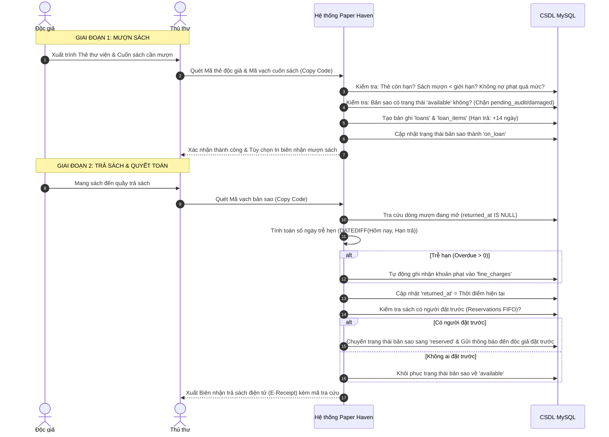
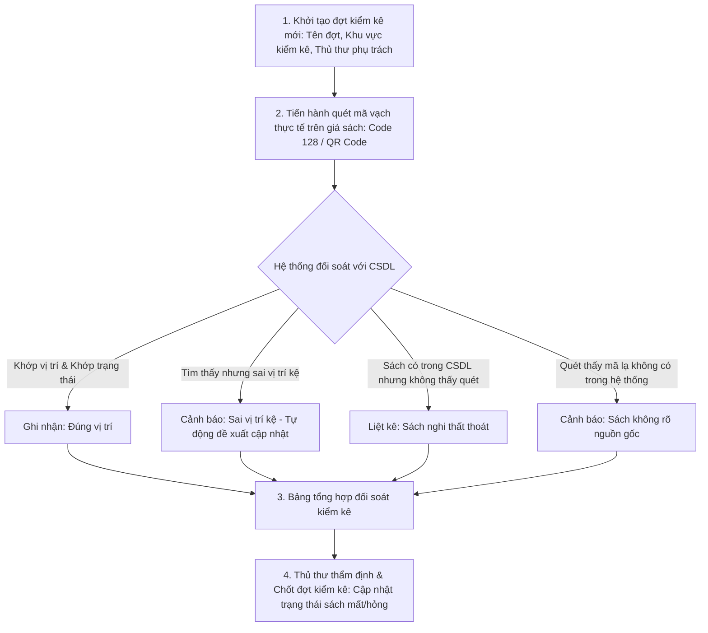

# ĐỒ ÁN MÔN HỌC: LẬP TRÌNH MÃ NGUỒN MỞ
## PHẦN 6: QUY TRÌNH NGHIỆP VỤ THƯ VIỆN CHUYÊN SÂU (CIRCULATION, FINES, AUDIT, RESERVATIONS)

---

## 1. QUY TRÌNH LƯU THÔNG SÁCH (CIRCULATION WORKFLOW)

Quy trình lưu thông là trái tim của hệ thống Paper Haven, kết nối chặt chẽ giữa Độc giả, Thủ thư và Kho bản sao vật lý.

---

## 2. QUY TRÌNH TỰ ĐỘNG TÍNH PHÍ PHẠT VÀ QUYẾT TOÁN TÀI CHÍNH

### 2.1. Công thức tính phí phạt lũy tiến
Phí phạt trễ hạn được quản lý bởi `FineService` theo công thức:

$$\text{Fine Amount} = \max(0, \text{Ngày trễ hạn}) \times \text{Mức phạt ngày}$$

* Mức phạt mặc định: **5.000 VNĐ / ngày / cuốn** (được cấu hình linh hoạt trong `system_settings`).
* Cơ chế khóa chống trùng lặp (`deduplication_key`): Định dạng `overdue_{loan_item_id}_{charge_date}`, đảm bảo không bao giờ phạt hai lần cho cùng một ngày vi phạm.

### 2.2. Quy trình thu tiền và Phân bổ thanh toán (Fine Allocation)
1. Khi độc giả nộp tiền mặt hoặc chuyển khoản, thủ thư tạo phiếu thu `fine_payments`.
2. Hệ thống tự động phân bổ số tiền đã nộp vào các khoản phạt chưa thanh toán (`fine_charges`) theo nguyên tắc FIFO (khoản phạt phát sinh trước được tất toán trước) thông qua bảng `fine_payment_allocations`.
3. Khi tổng số tiền phân bổ đạt bằng số tiền phạt, khoản phạt được đánh dấu hoàn tất.
4. Trường hợp độc giả có lý do chính đáng (ốm đau, thiên tai, sách bị giữ do sự cố khách quan), Quản trị viên có quyền thực hiện **Miễn giảm phạt (Waiver)** qua bảng `fine_waivers`. Thủ thư bình thường không có quyền này nhằm đảm bảo tính minh bạch tài chính.

---

## 3. QUY TRÌNH GIỮ CHỖ SÁCH TỰ ĐỘNG (FIFO RESERVATION QUEUE)

Khi một đầu sách có tất cả các bản sao đều đang được mượn (`available = 0`):
1. **Đặt trước (Enqueue):** Độc giả ấn nút "Đặt trước" trên giao diện chi tiết sách. Hệ thống kiểm tra điều kiện (chưa mượn cuốn này, chưa đặt trước cuốn này) và xếp bạn đọc vào hàng đợi `reservations` với trạng thái `pending` và số thứ tự `queue_position`.
2. **Kích hoạt tự động (Auto-dispatch):** Ngay khi một bản sao của đầu sách đó được trả lại tại quầy, hệ thống tìm bản ghi đặt trước có `queue_position` nhỏ nhất:
   - Cập nhật trạng thái đặt trước thành `ready_for_pickup`.
   - Giữ bản sao đó ở trạng thái dành riêng trong 48 giờ (không cho độc giả vãng lai mượn).
   - Tự động tạo bản ghi `notifications` thông báo đến độc giả mời đến nhận sách.
3. **Hoàn tất hoặc Hết hạn:** Nếu độc giả đến mượn trong 48 giờ, phiếu đặt chuyển thành `fulfilled`. Nếu quá 48 giờ không đến lấy, phiếu chuyển thành `expired`, bản sao tự động chuyển sang cho người tiếp theo trong hàng đợi hoặc trả về kệ tự do.

---

## 4. QUY TRÌNH KIỂM KÊ KHO SÁCH VÀ ĐỐI SOÁT MÃ VẠCH (INVENTORY AUDIT)

Hệ thống cung cấp giải pháp kiểm kê chuyên nghiệp giải quyết triệt để vấn đề lệch sổ sách:

* **Công nghệ tạo mã:** Hệ thống tự tạo mã vạch chuẩn **Code 128** và mã **QR Code** định dạng vector SVG thuần túy qua `BarcodeService` và `QrCodeService`. Không cần gọi đến Google Charts API hay dịch vụ bên ngoài, bảo đảm hoạt động độc lập và bảo mật thông tin nội bộ thư viện.

---

## 5. QUY TRÌNH NHẬP SÁCH AN TOÀN BẰNG FILE CSV (SAFE IMPORT PIPELINE)

Để hỗ trợ nhập danh mục hàng ngàn cuốn sách từ các nhà cung cấp:
1. **Thẩm định cấu trúc trước khi nhập (Pre-validation):** Kiểm tra các cột bắt buộc (`title`, `category`, `author`, `copies_count`, `shelf_location`).
2. **Đối soát tính duy nhất:** Tự động loại bỏ các dòng có ISBN trùng lặp hoặc mã bản sao đã tồn tại trong CSDL.
3. **Thực thi trong Giao dịch nguyên tử (Atomic Database Transaction):** Sử dụng `PDO::beginTransaction()`. Nếu xảy ra bất kỳ lỗi dữ liệu nào ở dòng thứ $N$, toàn bộ thao tác sẽ được `rollBack()`, đảm bảo CSDL không bao giờ bị rơi vào trạng thái dở dang rác dữ liệu.
4. **Cô lập vào khu vực an toàn:** Đối với các đợt nhập sách chưa được thẩm định chất lượng thực tế, các bản sao mới được gán trạng thái `pending_audit` và vị trí *"Kho tiếp nhận — Chờ kiểm kê"*, cách ly hoàn toàn khỏi quy trình mượn trả cho đến khi thủ thư hoàn thành kiểm kê vật lý.
