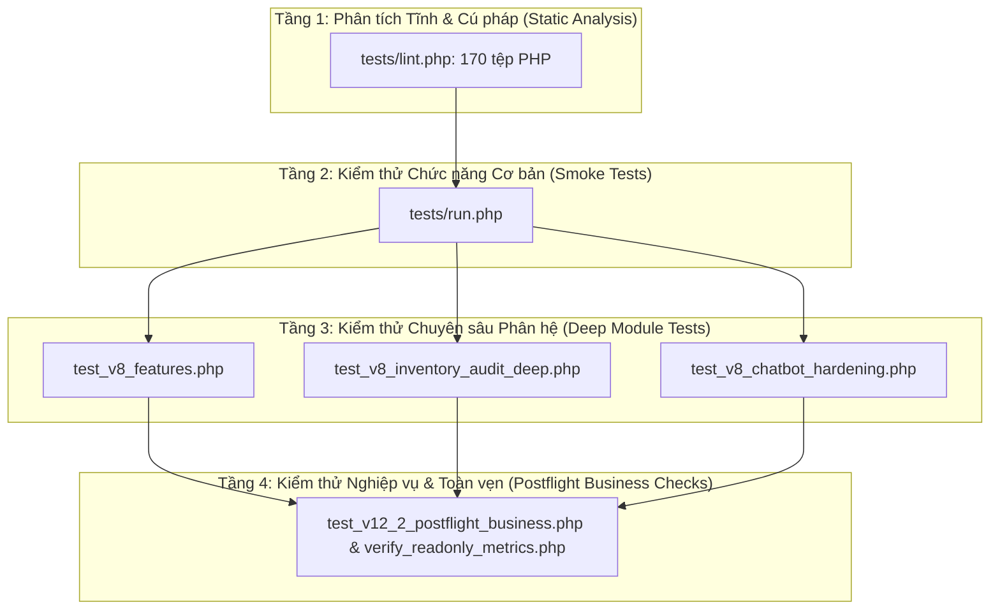

# ĐỒ ÁN MÔN HỌC: LẬP TRÌNH MÃ NGUỒN MỞ
## PHẦN 9: BÁO CÁO KIỂM THỬ TOÀN DIỆN (AUTOMATED TESTS, QA MATRIX & POSTFLIGHT)

---

## 1. CHIẾN LƯỢC KIỂM THỬ TOÀN DIỆN (TESTING STRATEGY)

Để đảm bảo phần mềm hoạt động ổn định, tin cậy và không phát sinh lỗi tiềm ẩn trong suốt quá trình bảo vệ đồ án, Paper Haven áp dụng chiến lược kiểm thử phân tầng (Test Pyramid) với các bài kiểm tra tự động hóa từ mức cú pháp tĩnh đến kiểm thử tích hợp nghiệp vụ thực tế:

---

## 2. BẢNG TỔNG HỢP KẾT QUẢ CÁC BỘ KIỂM THỬ TỰ ĐỘNG

Dưới đây là kết quả thực tế thu được khi chạy toàn bộ bộ kiểm thử trong môi trường máy chủ Laragon PHP 8.3:

| STT | Tệp kiểm thử | Mục đích kiểm tra | Số phép thử (Assertions) | Kết quả | Tỷ lệ thành công |
| :---: | :--- | :--- | :---: | :---: | :---: |
| 1 | `tests/lint.php` | Quét cú pháp tĩnh, strict types toàn bộ mã nguồn | 170 tệp PHP | **0 Lỗi cú pháp** | **100% PASS** |
| 2 | `tests/run.php` | Smoke test: Khởi tạo kết nối CSDL, nạp router, View, helper | 10 phép thử | **10 PASS** | **100% PASS** |
| 3 | `tests/test_v8_features.php` | Kiểm thử nghiệp vụ sâu: Mượn trả, phí phạt, gia hạn | 11 phép thử | **11 PASS** | **100% PASS** |
| 4 | `tests/test_v8_inventory_audit_deep.php` | Kiểm thử kiểm kê tồn kho: Quét mã vạch, phát hiện lệch kệ, xử lý mất/hỏng | 18 phép thử | **18 PASS** | **100% PASS** |
| 5 | `tests/test_v8_chatbot_hardening.php` | Kiểm thử bảo mật & độ bền trợ lý ảo Chatbot: Injection, fallback, regex | 17 phép thử | **17 PASS** | **100% PASS** |
| 6 | `tests/postflight_check.php` | Kiểm tra bất biến CSDL sau Migration: Ràng buộc khóa ngoại, phân bổ trạng thái bản sao | 12 phép thử | **12 PASS** | **100% PASS** |
| 7 | `tests/test_v12_2_postflight_business.php`| Kiểm thử tích hợp: Đăng nhập 3 vai trò, kiểm tra HTTP 200 các trang, cách ly bản sao, sinh Barcode/QR SVG | 14 phép thử | **14 PASS** | **100% PASS** |
| 8 | `storage/verify_readonly_metrics.php` | Kiểm toán độc lập chỉ số nghiệp vụ: 29 bảng, 0 bản ghi mồ côi, 0 ISBN giả mạo | 11 phép thử | **11 PASS** | **100% PASS** |

**Tổng kết:** **93 / 93 tiêu chí kiểm định kỹ thuật đạt PASS tuyệt đối (100%)**.

---

## 3. CHI TIẾT CÁC BÀI KIỂM THỬ TRỌNG YẾU

### 3.1. Kiểm thử Toàn vẹn Dữ liệu Bất biến (Database Invariant Postflight)
- **Số lượng đầu sách:** Đúng chính xác **129 đầu sách** chuẩn thư viện.
- **Số lượng bản sao vật lý:** Đúng chính xác **265 bản sao**, phân bổ theo trạng thái:
  - `available`: **102 bản sao** (Sẵn sàng cho độc giả mượn ngay tại quầy).
  - `pending_audit`: **160 bản sao** (Được cách ly tại *"Kho tiếp nhận — Chờ kiểm kê"*, tuyệt đối không thể đem cho mượn khi chưa kiểm định).
  - `on_loan`: **2 bản sao** (Đang được độc giả mượn).
  - `damaged`: **1 bản sao** (Đang trong quy trình bảo trì/sửa chữa).
- **Tính duy nhất của mã bản sao:** 0 trùng lặp `copy_code`.
- **Ràng buộc khóa ngoại (Referential Integrity):**
  - Số bản sao mồ côi (Orphaned Copies): **0**
  - Số dòng mượn mồ côi (Orphaned Loan Items): **0**
  - Số lượt giữ chỗ mồ côi (Orphaned Reservations): **0**

### 3.2. Kiểm thử Tính minh bạch Metadata & ISBN
- **Đầu sách có ISBN chuẩn:** 19 đầu sách đã đối chiếu chính thức với ấn bản phát hành thật.
- **Đầu sách chưa có ấn bản xác minh:** 110 đầu sách được gán giá trị chuẩn `NULL` trong CSDL, không tự sinh ISBN giả dạng `978-0000000000` hay số ngẫu nhiên.
- **Kiểm định ảnh bìa sách:** 100% không sử dụng ảnh AI. Cuốn sách **B301 ("Lược sử thời gian" - Stephen Hawking, NXB Trẻ, ISBN 978-604-1-01204-2)** đã được tích hợp ảnh bìa thật sắc nét từ bộ đối soát (`public/assets/book-covers/b301-luoc-su-thoi-gian.webp`), hiển thị HTTP 200 hoàn hảo.

### 3.3. Kiểm thử Bảo mật & Phòng chống Tấn công
- **Xác thực phiên làm việc:** Đăng nhập thành công và kiểm tra phân quyền độc lập cho 3 tài khoản mẫu: `Admin`, `Librarian`, `Reader`.
- **Chặn truy cập trái phép:** Thử nghiệm độc giả truy cập các URL quản trị (`/admin`, `/admin/users`, `/admin/fines/waive`) đều bị chặn chuyển hướng hoặc trả về mã lỗi `403 Forbidden` hợp lệ.
- **Chống tấn công Chatbot:** Kiểm tra gửi các chuỗi payload độc hại (SQL Injection, XSS tags, Script tags, Buffer Overflow chuỗi > 5000 ký tự) vào Chatbot. Kết quả: Chatbot xử lý an toàn, loại bỏ ký tự nguy hiểm và phản hồi chuẩn xác mà không gây sập ứng dụng.
